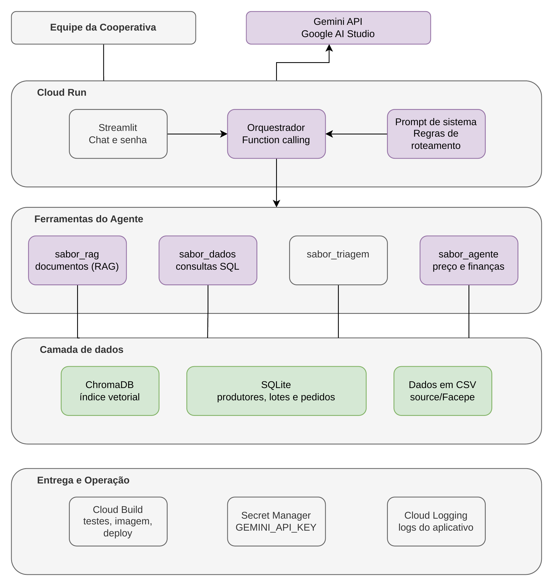

# 🌱 Sabor da Terra — Assistente Inteligente da Cooperativa

Assistente conversacional multi-agente desenvolvido para apoiar a operação comercial, documental e logística da **Cooperativa Sabor da Terra** (Garanhuns/PE). O sistema unifica triagem automatizada de pedidos em linguagem natural, busca semântica em normas técnicas e certificações (RAG), consultas estruturadas de estoque/preços/produtores e governança de dados sensíveis.

---

## 👨‍💻 Minha contribuição — Mikhael Vinicius | RAG Engineer

Neste projeto colaborativo, fui responsável pela **engenharia, arquitetura, desenvolvimento e implementação de ponta a ponta do módulo de RAG (Retrieval-Augmented Generation) e da base documental**, incluindo sua integração à arquitetura de agentes de IA do sistema.

### Principais responsabilidades e entregas

- **Arquitetura RAG:** concepção e implementação de um pipeline modular de ingestão, indexação e recuperação semântica de documentos em Python.
- **Processamento documental:** carregamento de certificações, contratos e fichas técnicas, extração de metadados, mascaramento de dados sensíveis (PII) e divisão de textos em *chunks* com sobreposição, preservando contexto e rastreabilidade.
- **Embeddings e banco vetorial:** integração com `gemini-embedding-001` (vetores de 3.072 dimensões) e implementação da persistência e indexação no ChromaDB. Na base documental trabalhada, foram indexados **20 documentos e 45 chunks**.
- **Recuperação semântica:** implementação do *Retriever* com busca por similaridade de cosseno, filtros por categoria documental, seleção `top_k`, limiar de relevância e retorno de trechos acompanhados de fontes e pontuações de similaridade.
- **Integração com AI Agents:** desenvolvimento da ferramenta `consultar_documentos()` e integração ao orquestrador Gemini por *Function Calling*, separando a recuperação documental da geração centralizada de respostas e evitando uma etapa generativa redundante.
- **Resiliência e integração:** contribuição para o tratamento de falhas transitórias da API Gemini, com *timeout*, *retry* e *fallback* entre modelos, preservando o histórico da conversa, além de correções de integração entre módulos.
- **Qualidade e validação:** desenvolvimento de testes automatizados de processamento documental, recuperação e integração, testes de regressão para falhas do Gemini e validação prática de consultas com rastreabilidade das fontes.

**Competências aplicadas:** Python · RAG · Generative AI · LLMs · AI Agents · Function Calling · Semantic Search · Embeddings · ChromaDB · Google Gemini API · Data Privacy · Software Architecture · Automated Testing · Git.

> O sistema foi desenvolvido em equipe. As contribuições acima descrevem minha atuação individual, sem atribuir a mim a autoria dos demais módulos do projeto.

---

## 🏗️ Arquitetura e Módulos Integrados



O projeto foi desenvolvido em frentes modulares e consolidado em uma arquitetura orientada a ferramentas (*Tool Calling*):

* **Interface, Orquestração & Cloud/DevOps (`app.py`, `core/`, `deploy/`)**
  * Interface web conversacional construída em **Streamlit** com histórico multi-turno, botão de reinício de sessão, proteção opcional por senha (`APP_PASSWORD`) e painel de transparência mostrando ferramentas acionadas, argumentos, retornos e latência (`ms`).
  * Orquestrador central (`core/orchestrator.py` e `core/integracao.py`) que descobre e acopla automaticamente as ferramentas de cada domínio.
  * Containerização com **Docker** (`Dockerfile`, `deploy/entrypoint.sh`) e pipeline de deploy automatizado para **Google Cloud Run** via **Cloud Build** (`cloudbuild.yaml`, `deploy/setup_gcp.sh`, `deploy/deploy.sh`).

* **Triagem Comercial de Pedidos (`src/triagem/`, `sabor_triagem/`)**
  * Pipeline híbrido que combina **Google Gemini (`gemini-3.8-flash`)** com extração estruturada via **Pydantic** (`schemas.py`) e regras determinísticas em Python (`regras.py`).
  * Tolera mensagens informais, abreviações e erros ortográficos (estilo WhatsApp), normalizando itens do catálogo, calculando prazos e urgência (`alta` para entregas em menos de 48h), detectando ambiguidades (ex.: *mel silvestre* vs. *mel de jandaíra*) e mantendo estado incremental (`pedido_pendente`) entre turnos.

* **Base Documental & RAG (`sabor_rag/`, `data/processed/raw/documents/`)**
  * Pipeline de ingestão, limpeza/redação de dados sensíveis (`redaction.py`), *chunking* (`chunking.py`), geração de *embeddings* e busca vetorial com **ChromaDB** (`vector_store.py`, `retriever.py`).
  * Indexa certificados orgânicos, laudos sanitários (ADAGRO / SIE / Selo Arte), contratos institucionais (como PNAE) e fichas técnicas de produtos, respondendo com citação explícita das fontes.

* **Engenharia de Agentes & Consultas Estruturadas (`sabor_agent/`, `sabor_agentes/`, `docs/ferramentas-agente.md`)**
  * Conjunto de ferramentas tipadas com formatadores dedicados (`formatters.py`):
    * `get_producer_summary`: consolida vendas, volumes (kg) e status de pagamentos (`pago`, `pendente`, `unclassified`) por produtor (`Pxxx`) e intervalo de datas (`AAAA-MM-DD`).
    * `lookup_price`: consulta a tabela vigente de preços (`matches` exatos e `suggestions` de variantes) sem inferir valores inexistentes.
    * `lookup_lot`: rastreabilidade operacional de lotes com **mascaramento obrigatório de nome e CPF do produtor** por política de privacidade.
    * `draft_producer_order_notifications`: recebe o JSON estruturado de um pedido triado com status `pronto`, valida produtor ativo e certificação orgânica vigente, aloca automaticamente apenas quando há um único produtor elegível e gera rascunhos de notificação sem copiar dados pessoais do comprador.

* **Tratamento de Dados & Persistência (`data/processed/`, `src/database/`, `src/agents/`)**
  * Pipelines de higienização e padronização dos datasets brutos (`produtores_tratado.csv`, `lotes_tratado.csv`, `precos_tratados.csv`, `financeiro_tratado.csv`, `sazonalidade_tratado.csv` e `pedidos.json`).
  * Carga e consulta relacional em **SQLite** (`src/database/carregar_sql.py` → `data/sabor_da_terra.db`) com ferramentas SQL dedicadas (`src/agents/ferramentas_sql.py`).

---

## 📁 Estrutura do Repositório

```text
SaborDaTerra-AI/
├── .streamlit/
│   └── config.toml               # Configurações de tema e servidor do Streamlit
├── core/
│   ├── __init__.py
│   ├── config.py                 # Configurações globais e leitura de variáveis de ambiente
│   ├── integracao.py             # Descoberta e acoplamento dinâmico das tools dos módulos
│   ├── llm.py                    # Cliente de comunicação com a API do Google Gemini
│   └── orchestrator.py           # Orquestrador central de function calling e sessão
├── data/
│   ├── chroma/                   # Base vetorial persistente do ChromaDB (gerada localmente)
│   ├── processed/                # Datasets tratados (CSVs/JSON) e documentos brutos da cooperativa
│   └── sabor_da_terra.db         # Banco de dados relacional SQLite (gerado localmente)
├── deploy/
│   ├── deploy.sh                 # Script de build e deploy no Google Cloud Run
│   ├── entrypoint.sh             # Ponto de entrada do container em produção
│   └── setup_gcp.sh              # Provisionamento inicial de APIs e permissões no GCP
├── docs/
│   ├── ferramentas-agente.md     # Especificação técnica e contratos das ferramentas do agente
│   └── Sabor_da_Terra.png        # Diagrama de arquitetura do sistema
├── sabor_agent/
│   ├── __init__.py
│   ├── data_tools.py             # Consultas tabulares (produtores, preços e lotes)
│   ├── formatters.py             # Formatadores de resposta e rascunhos de notificação
│   └── orchestrator.py           # Despacho local das ferramentas estruturadas
├── sabor_agentes/
│   └── tool.py                   # Adaptador público (TOOLS) para o orquestrador
├── sabor_dados/
│   ├── __init__.py
│   └── tool.py                   # Adaptador de consulta aos dados estruturados
├── sabor_rag/
│   ├── __init__.py
│   ├── chunking.py               # Divisão dos documentos em chunks com sobreposição
│   ├── config.py                 # Parâmetros do pipeline RAG e modelos
│   ├── embeddings.py             # Geração de embeddings com gemini-embedding-001
│   ├── indexer.py                # Indexação dos chunks no ChromaDB
│   ├── loader.py                 # Carregamento de documentos e extração de metadados
│   ├── models.py                 # Modelos de dados de documentos, chunks e citações
│   ├── redaction.py              # Sanitização e mascaramento de dados sensíveis (PII)
│   ├── retriever.py              # Busca semântica por similaridade de cosseno
│   ├── tool.py                   # Interface pública do módulo RAG para o agente
│   └── vector_store.py           # Gerenciamento da coleção persistente no ChromaDB
├── sabor_triagem/
│   ├── __init__.py
│   └── tool.py                   # Interface pública do módulo de triagem para o agente
├── scripts/
│   ├── __init__.py
│   ├── build_index.py            # Script CLI para construir o índice vetorial (RAG)
│   ├── demo_data_tools.py        # Script CLI de demonstração das consultas tabulares
│   └── testar_vector_store.py    # Utilitário de teste de recuperação no ChromaDB
├── src/
│   ├── agents/
│   │   └── ferramentas_sql.py    # Ferramentas de consulta relacional no SQLite
│   ├── database/
│   │   ├── carregar_sql.py       # Carga dos datasets tratados para o banco SQLite
│   │   ├── config.py             # Caminhos e configurações do banco SQLite
│   │   └── vector_store.py       # Integração auxiliar de armazenamento vetorial
│   └── triagem/
│       ├── __init__.py
│       ├── data_pipeline.py      # Carregamento e preparação do catálogo/regras
│       ├── parser.py             # Extração estruturada de pedidos via Gemini
│       ├── pipeline.py           # Fluxo principal de execução da triagem
│       ├── prompts.py            # Prompts de sistema e instruções de extração
│       ├── regras.py             # Validações determinísticas, urgência e ambiguidades
│       ├── relatorios.py         # Geração de resumos e logs da triagem
│       ├── schemas.py            # Modelos Pydantic de entrada e saída da triagem
│       └── tools.py              # Ferramentas auxiliares do fluxo de triagem
├── tests/
│   ├── test_chunking.py
│   ├── test_core_orchestrator_resilience.py
│   ├── test_data_tools.py
│   ├── test_formatters.py
│   ├── test_integracao.py
│   ├── test_loader.py
│   ├── test_orchestrator.py
│   ├── test_rag_tool.py
│   ├── test_sabor_agentes_tool.py
│   └── test_triagem.py
├── .dockerignore                 # Arquivos ignorados no build da imagem Docker
├── .env.example                  # Modelo de variáveis de ambiente
├── .gitignore                    # Arquivos e diretórios ignorados pelo Git
├── app.py                        # Aplicação principal da interface web Streamlit
├── cloudbuild.yaml               # Pipeline CI/CD no Google Cloud Build
├── Dockerfile                    # Definição da imagem Docker de produção
├── README.md                     # Documentação geral do projeto
└── requirements.txt              # Dependências Python do projeto
```

---

## 🚀 Como Executar Localmente

### 1. Pré-requisitos
* **Python 3.11+** (testado em Python 3.14)
* Chave de API do **Google Gemini** (`GEMINI_API_KEY`)

### 2. Instalação
Clone o repositório, crie o ambiente virtual e instale as dependências:

```bash
git clone https://github.com/EdieneGomes/SaborDaTerra-AI.git
cd SaborDaTerra-AI

python -m venv .venv

# Windows (PowerShell)
.\.venv\Scripts\Activate.ps1

# Linux / macOS
source .venv/bin/activate

pip install -r requirements.txt
```

### 3. Configuração de Variáveis de Ambiente
Copie o arquivo de exemplo e preencha sua chave da API:

```bash
cp .env.example .env
```

Principais variáveis no `.env`:
```env
GEMINI_API_KEY=sua_chave_aqui
GEMINI_MODEL=gemini-3.8-flash
APP_PASSWORD=                  # Opcional: define senha de acesso na tela inicial
MOSTRAR_FERRAMENTAS=true       # Exibe o painel técnico de chamadas de ferramentas no chat
```

### 4. Preparação dos Dados e Índice Vetorial (RAG)
Antes de iniciar a interface pela primeira vez, popule o banco SQLite e construa o índice documental do ChromaDB:

```bash
python -m src.database.carregar_sql
python -m scripts.build_index
```

### 5. Executar a Aplicação
```bash
python -m streamlit run app.py
```
A aplicação ficará disponível em `http://localhost:8501`.

---

## 🧪 Testes Automatizados

O projeto conta com suíte de testes unitários e de integração cobrindo triagem, regras de negócio, chunking/loader do RAG, formatadores, ferramentas de dados e resiliência do orquestrador:

```bash
python -m pytest tests/ -v
```

---

## ☁️ Deploy em Nuvem (Google Cloud Run)

O repositório já inclui automação para implantação conteinerizada no GCP:

1. **Configuração inicial de APIs e permissões no GCP:**
   ```bash
   bash deploy/setup_gcp.sh
   ```
2. **Build e deploy no Cloud Run:**
   ```bash
   bash deploy/deploy.sh
   ```
   *(Ou via gatilho automatizado utilizando `cloudbuild.yaml`).*

---

## 🔒 Governança e Privacidade de Dados

* **Proteção de PII:** Consultas de rastreabilidade de lotes (`lookup_lot`) omitem automaticamente nome e CPF dos produtores.
* **Recusa de Dados Sensíveis:** O assistente bloqueia solicitações de dados bancários, documentos pessoais ou informações confidenciais de cooperados.
* **Fidelidade Documental:** Respostas sobre preços, estoque e certificações são estritamente vinculadas às tabelas vigentes e documentos indexados, sinalizando indisponibilidade ou certificados vencidos sem inventar valores.

---

## 📚 Documentação Complementar

* [`docs/ferramentas-agente.md`](docs/ferramentas-agente.md) — Especificação técnica, contratos JSON Schema e regras de comportamento das ferramentas estruturadas.
